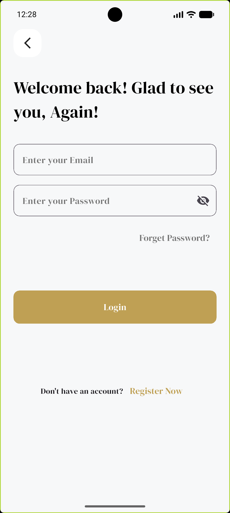
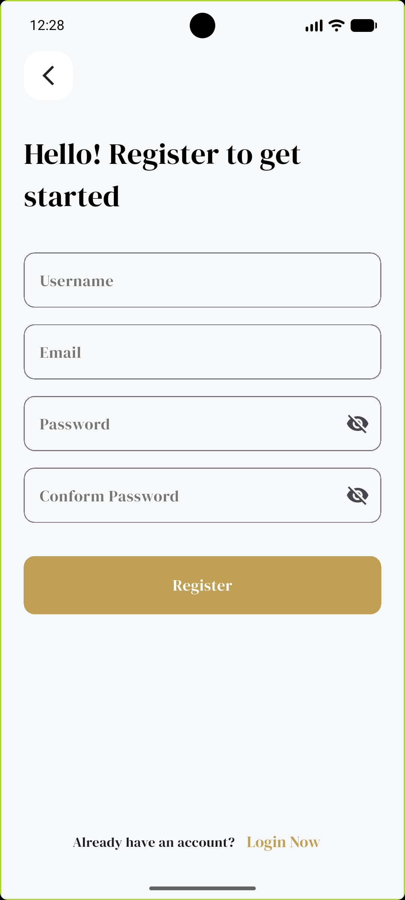
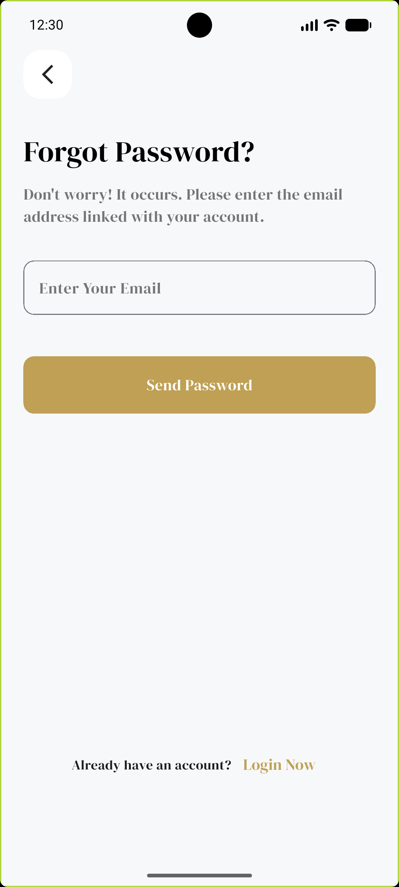
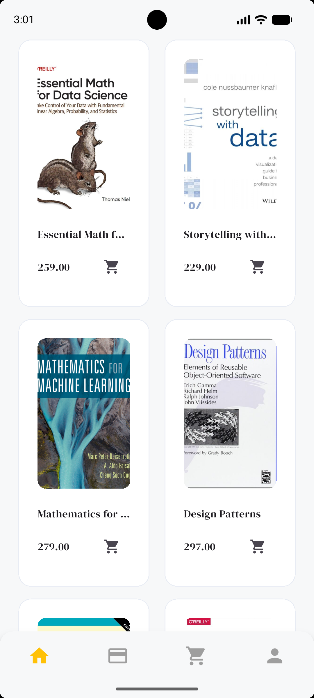
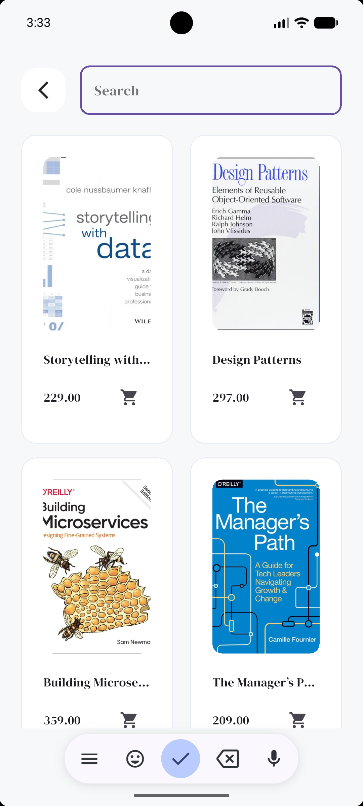
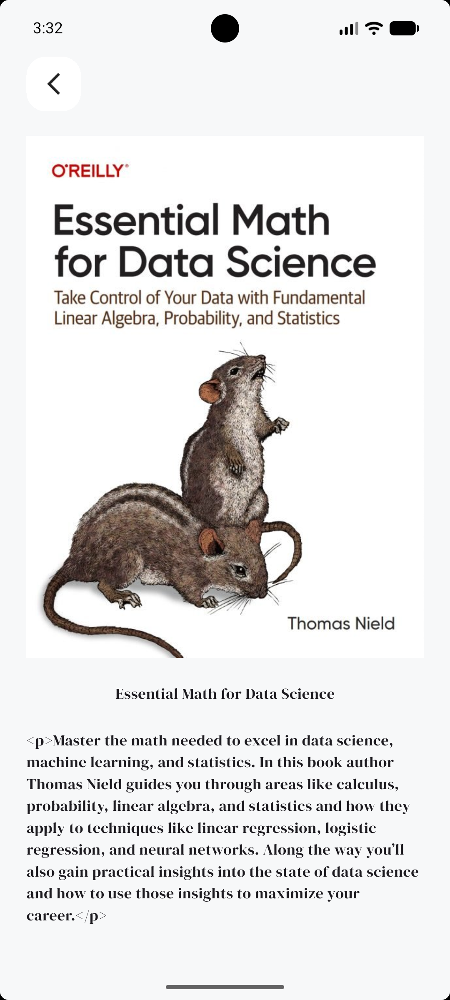
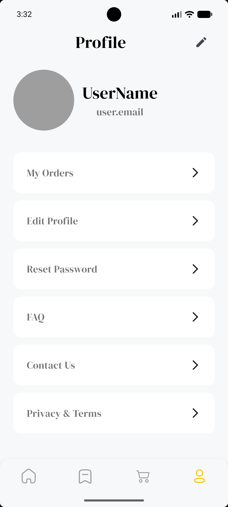

from pathlib import Path

readme = """# 📚 Bookia App

A Flutter application focused on providing a book-related mobile experience, with authentication screens, book browsing, search, book details, and reusable UI components.

## ✨ Features

- **User Login** — Email and password fields with input validation.
- **User Registration** — Username, email, password, and password confirmation.
- **Form Validation** — Validate user input before submitting authentication requests.
- **Password Visibility** — Toggle password visibility in password fields.
- **Authentication State Management** — Handle authentication states using Cubit and Bloc.
- **API Communication** — Send HTTP requests using Dio.
- **Best Sellers** — Fetch and display best-selling books from the API.
- **Search Screen** — Search interface for finding books.
- **Book Details Screen** — A dedicated screen for viewing book details.
- **Profile Screen** — Profile page with navigation options for My Orders, Edit Profile, Reset Password, FAQ, Contact Us, and Privacy & Terms.
- **Logout Entry Point** — Logout icon in the profile header.
- **Named Navigation** — Navigate between screens using named routes.
- **Responsive UI** — Use Flutter ScreenUtil for screen-aware sizing.
- **Reusable Widgets** — Custom text fields, buttons, book items, and profile cards.
- **Localization Support** — Easy Localization package is included in the project dependencies.

## 🛠️ Technologies

- Flutter
- Dart
- flutter_bloc
- Dio
- flutter_screenutil
- easy_localization

## 📂 Project Structure

```text
lib/
├── core/
│   ├── routes/
│   ├── theme/
│   ├── utils/
│   │   └── validator/
│   ├── networking/
│   └── widgets/
└── feature/
    ├── auth/
    │   └── presentation/
    │       └── cubit/
    ├── home/
    │   ├── data/
    │   │   ├── models/
    │   │   └── repo/
    │   └── presentation/
    │       ├── cubit/
    │       ├── screens/
    │       └── widgets/
    ├── search/
    │   └── presentation/
    │       ├── screens/
    │       └── widgets/
    ├── details/
    │   └── presentation/
    │       ├── screens/
    │       └── widgets/
    └── profile/
        └── presentation/
            ├── screens/
            └── widgets/
```

> This is a high-level example of the project structure. Adjust folder names if they differ from the current repository.

## 🚀 Getting Started

### Prerequisites

- Flutter SDK
- Dart SDK
- Android Studio or Visual Studio Code

### Installation

1. Clone the repository:

   ```bash
   git clone https://github.com/Muhamed-Sultan/bookia_app.git
   ```

2. Navigate to the project directory:

   ```bash
   cd bookia_app
   ```

3. Install dependencies:

   ```bash
   flutter pub get
   ```

4. Configure the API endpoints in the networking configuration if needed.

5. Run the application:

   ```bash
   flutter run
   ```

## 🔌 API Integration

The application uses Dio for API communication and Cubit/Bloc for managing asynchronous UI states, including loading, success, and error states.

Configure API endpoints according to the backend used by the project.

---

## 📱 App Screenshots

> Place the corresponding screenshots in the `images/` folder in the repository. The filenames below must match the actual image filenames.

### 🏠 Welcome Screen

<p align="center">
  
</p>

### 🔐 Login Screen

<p align="center">
  
</p>

### 📝 Register Screen

<p align="center">
  
</p>

### 🔑 Forgot Password Screen

<p align="center">
  
</p>

### 🔒 New Password Screen

<p align="center">
  
</p>

### 📚 Home & Best Sellers

<p align="center">
  
</p>

### 🔎 Search Screen

<p align="center">
  
</p>

### 📖 Book Details Screen

<p align="center">
  
</p>

### 👤 Profile Screen

<p align="center">
  
</p>

---

## 👨‍💻 Developer

**Muhamed Salah Sultan**

Flutter Developer

- GitHub: [Muhamed-Sultan](https://github.com/Muhamed-Sultan)
- Repository: [Bookia App](https://github.com/Muhamed-Sultan/bookia_app)

---

**Built with Flutter 💙**
"""

path = Path("/mnt/data/README.md")
path.write_text(readme, encoding="utf-8")
print("Created full README.md with Search, Details, and Profile sections.")
